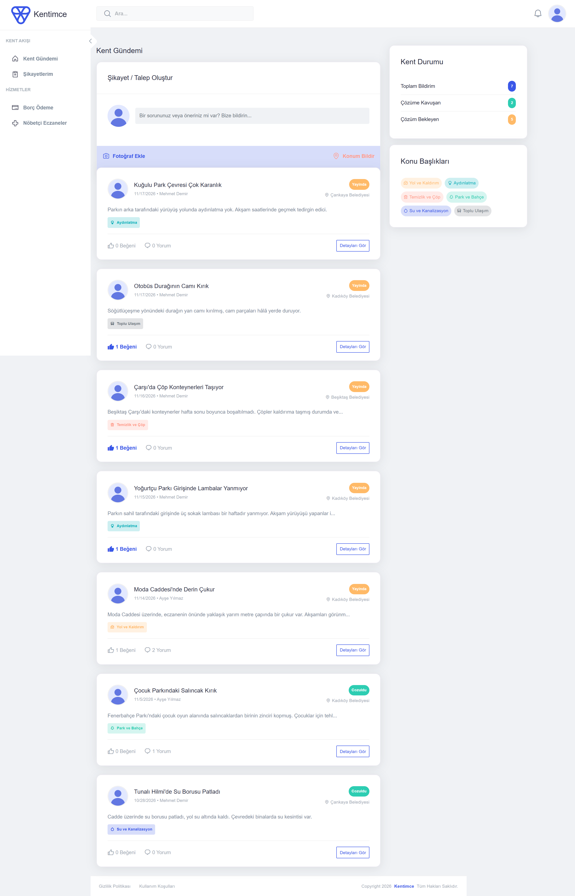
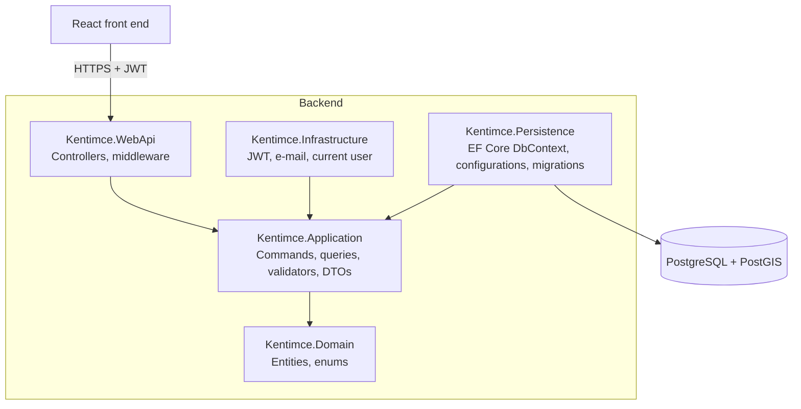
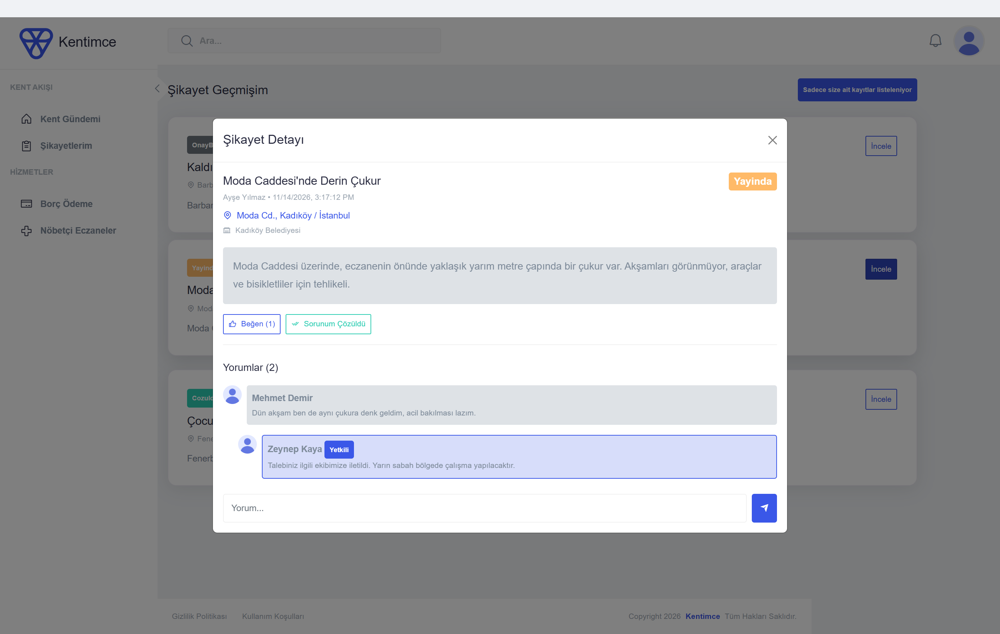
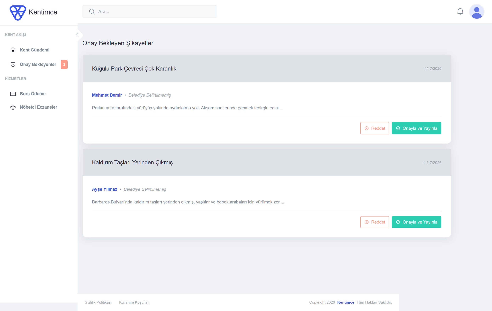
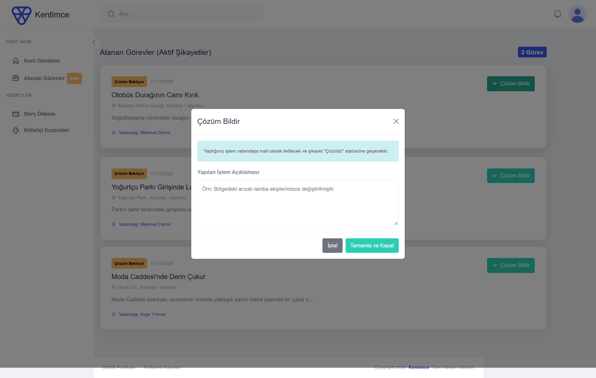
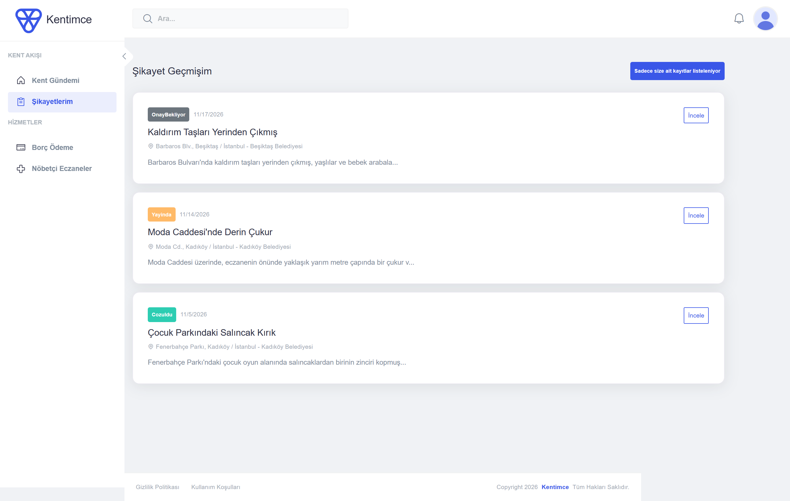
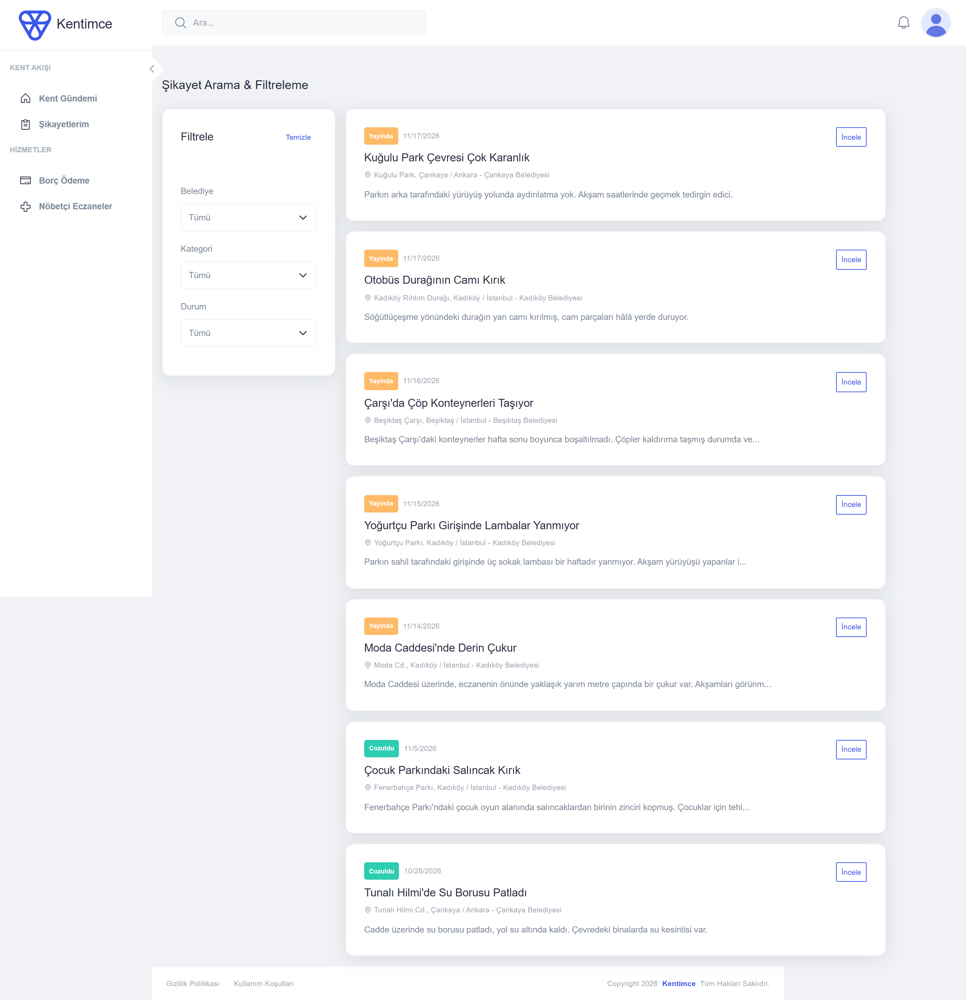
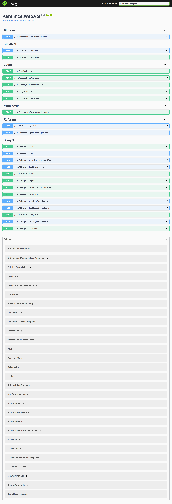

# Kentimce

**Kentimce** ("my city" in Turkish) is a civic complaint platform that connects citizens with their municipalities. Citizens report local problems such as potholes, broken street lights or overflowing bins; moderators review each report before it is published; municipal staff respond and mark issues as resolved. Other citizens can support reports with likes and comments, so the most pressing issues become visible.

This repository contains the **ASP.NET Core 8 Web API**. The React front end is built on a licensed commercial template and is kept in a private repository; screenshots are included below.



## Features

- **Complaint lifecycle** with full status history: *pending moderation → published → resolved* (or *rejected*)
- **Moderation queue**: new complaints are hidden until a moderator approves them; rejected complaints carry a reason
- **Profanity filter** that blocks complaints containing words from a configurable list
- **Three user roles**: citizen, municipal staff (linked to a municipality) and moderator
- **Municipal staff workflow**: staff see only their own municipality's active complaints and can post official replies and mark issues as resolved
- **Citizen interaction**: likes, comments, objections and confirmation that an issue has been resolved
- **Notifications** for status changes (e.g. "your complaint was approved")
- **Authentication**: registration with e-mail verification code, JWT access tokens with refresh tokens, BCrypt password hashing
- **City dashboard**: public feed, statistics and filtering by municipality, category and status

## Tech stack

| Area           | Technology                                                       |
| -------------- | ---------------------------------------------------------------- |
| API            | ASP.NET Core 8 Web API, Swagger                                  |
| Architecture   | Layered / Clean Architecture, CQRS with MediatR                  |
| Validation     | FluentValidation with a MediatR pipeline behavior                |
| Data           | Entity Framework Core 8, PostgreSQL (PostGIS enabled via NetTopologySuite) |
| Security       | JWT bearer authentication, refresh tokens, BCrypt                |
| Other          | AutoMapper, SMTP e-mail service                                  |
| Front end      | React, Vite, Bootstrap (private repository)                      |

## Architecture



- **Domain** contains the entities and has no dependencies.
- **Application** contains the use cases as MediatR commands and queries, each with its own handler and FluentValidation validator. It depends only on abstractions (`IAppDbContext`, `IJWTTokenService`, `IEmailService`, `ICurrentUserService`).
- **Infrastructure** and **Persistence** implement those abstractions.
- **WebApi** exposes the use cases over HTTP; a global exception middleware turns errors into consistent responses.

## Screenshots

| | |
| --- | --- |
| **Complaint detail** with status history and an official staff reply<br> | **Moderation queue**<br> |
| **Municipal staff view**<br> | **My complaints**<br> |
| **Search and filter**<br> | **API (Swagger)**<br> |

## API overview

| Area         | Endpoints                                                                                     |
| ------------ | --------------------------------------------------------------------------------------------- |
| Auth         | `POST /api/Login/Register`, `MailDogrulama`, `KodTekrarGonder`, `Login`, `RefreshToken`        |
| Complaints   | `POST /api/Sikayet/Ekle`, `GET /api/Sikayet/{id}`, `GetSikayetlerim`, `GetByFilter`, `GetGlobalFeedQuery`, `GetGlobalStatsQuery` |
| Interaction  | `POST /api/Sikayet/YorumEkle`, `Begen`, `ItirazEt`, `CozulduIsaretleVatandas`                  |
| Staff        | `GET /api/Sikayet/GetBelediyeSikayetleri`, `POST /api/Sikayet/CozumBildir`                     |
| Moderation   | `GET /api/Sikayet/GetOnayBekleyenler`, `POST /api/Moderayon/SikayetModerasyon`                 |
| Other        | `GET /api/Bildirim/GetBildirimlerim`, `GET /api/Kullanici/GetProfil`, `POST /api/Kullanici/SifreDegistir`, `GET /api/Referans/getBelediyeler`, `getTumKategoriler` |

## Getting started

### Prerequisites

- [.NET 8 SDK](https://dotnet.microsoft.com/download/dotnet/8.0) (8.0.400 or later)
- PostgreSQL 16+ with the **PostGIS** extension available

### 1. Configure secrets

Secrets are not stored in the repository. Set them with .NET User Secrets from the `Kentimce.WebApi` folder:

```bash
cd Kentimce.WebApi
dotnet user-secrets set "ConnectionStrings:DefaultConnection" "Host=localhost;Port=5432;Database=kentimce;Username=postgres;Password=YOUR_PASSWORD"
dotnet user-secrets set "JwtSettings:SecurityKey" "A_RANDOM_KEY_OF_AT_LEAST_32_CHARACTERS"

# Optional: only needed for registration e-mails
dotnet user-secrets set "EmailSettings:User" "your-address@gmail.com"
dotnet user-secrets set "EmailSettings:Password" "YOUR_SMTP_APP_PASSWORD"
```

### 2. Create the database

```bash
# From the repository root: restores the project-local dotnet-ef tool (version 8)
dotnet tool restore
dotnet ef database update --project Kentimce.Persistence --startup-project Kentimce.WebApi
```

### 3. Load demo data (optional)

[`docs/demo-seed.sql`](docs/demo-seed.sql) adds sample municipalities, categories, complaints, comments and three demo users:

```bash
psql -U postgres -d kentimce -f docs/demo-seed.sql
```

| E-mail                   | Role                                  | Password   |
| ------------------------ | ------------------------------------- | ---------- |
| `ayse@kentimce.demo`     | Citizen                               | `Demo123!` |
| `personel@kentimce.demo` | Municipal staff (Kadıköy Municipality) | `Demo123!` |
| `admin@kentimce.demo`    | Moderator                             | `Demo123!` |

### 4. Run the API

```bash
dotnet run --project Kentimce.WebApi --launch-profile https
```

Swagger UI is available at `/swagger`.

## Glossary

The domain model uses Turkish names. The most common terms:

| Turkish          | English                    |
| ---------------- | -------------------------- |
| Şikayet          | Complaint                  |
| Belediye         | Municipality               |
| Personel         | Municipal staff            |
| Vatandaş         | Citizen                    |
| Kullanıcı        | User                       |
| Moderasyon       | Moderation                 |
| Yorum / Beğeni   | Comment / Like             |
| Bildirim         | Notification               |
| İl / İlçe        | Province / District        |
| Kategori         | Category                   |
| Durum            | Status                     |
| Onay Bekliyor / Yayında / Çözüldü / Reddedildi | Pending / Published / Resolved / Rejected |
| Kötü kelime      | Profanity (filter list)    |

## Roadmap

- Endpoint-level authorization policies (`[Authorize(Roles = ...)]`) in addition to the checks in the handlers
- Store complaint locations as PostGIS points and add a map view
- Unit tests for command handlers and validators
- Docker Compose setup with PostgreSQL and PostGIS

## License

MIT
